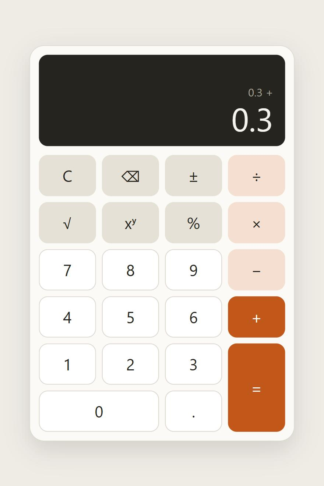

# Simple Calculator

[](https://github.com/pietromezzadri/simple-calculator/actions/workflows/ci.yml)
[](docs/coverage.md)
[](docs/coverage.md)

A full-stack calculator: a React and TypeScript keypad backed by a Go REST API. It adds, subtracts, multiplies, divides, raises to a power, takes square roots and works out percentages.

All arithmetic happens on the backend, in decimal rather than floating point, so `0.1 + 0.2` is exactly `0.3`.

<p align="center">
  <picture>
    <source media="(prefers-color-scheme: dark)" srcset="docs/screenshot-dark.jpg">
    
  </picture>
</p>

## Contents

- [Quick start with Docker](#quick-start-with-docker)
- [Running the frontend and backend](#running-the-frontend-and-backend)
- [Using the calculator](#using-the-calculator)
- [API](#api)
- [Tests and coverage](#tests-and-coverage)
- [Design decisions](#design-decisions)
- [Assumptions and limits](#assumptions-and-limits)
- [Project layout](#project-layout)

## Quick start with Docker

```bash
docker build -t simple-calculator .
docker run -p 8080:8080 simple-calculator
```

Then open <http://localhost:8080>. One container serves both the frontend and the API.

## Running the frontend and backend

You need Go 1.26 or newer and Node 24.

Start the backend, which listens on port 8080:

```bash
cd backend
go run ./cmd/server
```

In a second terminal, start the frontend:

```bash
cd frontend
npm install
npm run dev
```

Then open <http://localhost:5173>. Vite forwards `/api` requests to the backend.

### Configuration

| Variable | Used by | Default | Purpose |
|---|---|---|---|
| `PORT` | backend | `8080` | Port to listen on |
| `HOST` | backend | all interfaces | Address to bind, such as `127.0.0.1` |
| `STATIC_DIR` | backend | not set | Folder of built frontend files to serve |
| `API_TARGET` | frontend dev server | `http://localhost:8080` | Where to forward `/api` requests |

If port 8080 is already taken, set `PORT` and `API_TARGET` to match. For example, in Bash:

```bash
PORT=8090 go run ./cmd/server
```

```bash
API_TARGET=http://localhost:8090 npm run dev
```

## Using the calculator

Use the on-screen keys or the keyboard:

| Action | Key |
|---|---|
| Digits and decimal point | `0`–`9`, `.` or `,` |
| Add, subtract, multiply, divide | `+`, `-`, `*` or `x`, `/` |
| Power | `^` |
| Square root | `r` |
| Percent | `%` |
| Change sign | `n` |
| Equals | `Enter` or `=` |
| Delete last digit | `Backspace` |
| Clear | `Esc` or `Delete` |

- **Chaining** works left to right like a pocket calculator, with no operator precedence: `2 + 3 × 4 =` gives `20`.
- **Percent** works as it does on a phone calculator:
  - `200 + 10 %` means 10% of 200, so `=` gives `220`.
  - `200 × 10 %` means 200 × 0.1, so `=` gives `20`.
  - With nothing pending, `50 %` gives `0.5`.
- **Long results** are rounded to 16 significant digits on the display. Hover over the number to see the exact value, which is also what the next step of a calculation uses.
- **After an error**, your calculation is kept. In `5 ÷ 0 =`, typing `2` and pressing `=` gives `2.5`.

## API

The base path is `/api/v1`. Operands can be JSON numbers or numeric strings. Results are always strings, so clients don't lose precision.

| Method and path | Body | Result |
|---|---|---|
| `POST /api/v1/add` | `{"a", "b"}` | a + b |
| `POST /api/v1/subtract` | `{"a", "b"}` | a − b |
| `POST /api/v1/multiply` | `{"a", "b"}` | a × b |
| `POST /api/v1/divide` | `{"a", "b"}` | a ÷ b |
| `POST /api/v1/power` | `{"a", "b"}` | a to the power of b |
| `POST /api/v1/percentage` | `{"a", "b"}` | a percent of b |
| `POST /api/v1/sqrt` | `{"a"}` | square root of a |
| `GET /healthz` | none | `{"status":"ok"}` |

### Examples

These responses were captured from the running server.

```bash
curl -X POST http://localhost:8080/api/v1/add -d '{"a": 0.1, "b": 0.2}'
```
```json
{"result":"0.3"}
```

```bash
curl -X POST http://localhost:8080/api/v1/divide -d '{"a": 1, "b": 3}'
```
```json
{"result":"0.3333333333333333333333333333333333"}
```

```bash
curl -X POST http://localhost:8080/api/v1/power -d '{"a": 2, "b": 10}'
```
```json
{"result":"1024"}
```

```bash
curl -X POST http://localhost:8080/api/v1/percentage -d '{"a": 10, "b": 200}'
```
```json
{"result":"20"}
```

```bash
curl -X POST http://localhost:8080/api/v1/sqrt -d '{"a": 2}'
```
```json
{"result":"1.4142135623730950488016887242096981"}
```

Strings keep every digit:

```bash
curl -X POST http://localhost:8080/api/v1/add -d '{"a": "12345678901234567890.123456789", "b": "1"}'
```
```json
{"result":"12345678901234567891.123456789"}
```

### Errors

Every error has the same shape. `code` is stable, for programs to match on, and `message` can be shown to people.

```bash
curl -X POST http://localhost:8080/api/v1/divide -d '{"a": 1, "b": 0}'
```
```json
{"error":{"code":"division_by_zero","message":"Cannot divide by zero."}}
```

```bash
curl -X POST http://localhost:8080/api/v1/add -d '{"a": "abc", "b": 2}'
```
```json
{"error":{"code":"invalid_operand","message":"Operand \"a\" is not a valid number."}}
```

| Status | Code | When |
|---|---|---|
| 400 | `invalid_json` | The body is empty, malformed, not an object, or has unknown fields |
| 400 | `missing_operand` | An operand is absent or `null` |
| 400 | `invalid_operand` | An operand is not a number, or is outside the limits below |
| 404 | `not_found` | No such endpoint |
| 405 | `method_not_allowed` | Wrong HTTP method; the `Allow` header names the right one |
| 413 | `body_too_large` | The body is over 4 KB |
| 422 | `division_by_zero` | The divisor is zero |
| 422 | `negative_sqrt` | Square root of a negative number |
| 422 | `undefined_power` | `0` to a negative power, or a negative base with a fractional exponent |
| 422 | `out_of_range` | The result reaches 10¹⁰⁰, or the exponent is beyond ±1000 |
| 500 | `internal_error` | A bug on the server; details are logged, not returned |

## Tests and coverage

```bash
cd backend
go vet ./...
go test -cover ./...
```

```bash
cd frontend
npm run typecheck
npm run lint
npm test -- --coverage
```

| Layer | Statements | Notes |
|---|---|---|
| Backend `internal/calculator` | 95.6% | Every operation and edge case |
| Backend `internal/api` | 99.0% | Routing, validation, every error status |
| Backend `cmd/server` | 22.9% | Startup wiring, exercised by CI's Docker smoke test |
| Frontend | 100% (97.81% of branches) | Reducer, formatter, API client, whole-calculator flows |

[docs/coverage.md](docs/coverage.md) has the full report, including what isn't covered and why. CI runs all of this on every push, builds the Docker image, smoke tests it, and keeps the HTML coverage reports as build artifacts. Each push to `main` also updates the coverage badges at the top of this page. They show total statement coverage, read from figures CI publishes to the `badges` branch, so no outside coverage service is involved.

## Design decisions

**Decimal arithmetic instead of `float64`.** Floats give `0.1 + 0.2 = 0.30000000000000004`, which isn't acceptable from a calculator, and certainly not near money. The backend uses [`shopspring/decimal`](https://github.com/shopspring/decimal), its only dependency. Operands are read from their JSON source text and never pass through a float.

**Results are strings.** A JSON number would be parsed as a float by JavaScript clients, which would undo the exactness at the last step. The frontend holds the exact string and only rounds what it displays.

**Decimals need limits.** Unlike floats, decimals grow without bound, so `1e1000000000` could exhaust memory just by being printed. Operands, exponents, results and body size are all capped, and `Power` estimates a result's size before computing it. Tests time the worst-case requests. Keeping results within the operand limits also means any result can be sent back as the next operand.

**One endpoint per operation.** This reads clearly in logs and docs, and each route can validate its own shape: `sqrt` takes one operand and rejects a second. The routes are registered from a table, so adding an operation is one line plus its function.

**400 versus 422.** A 400 means the request itself is wrong, and a 422 means it was well formed but has no answer. A client can tell a bug in its own code from a user dividing by zero.

**Layers that don't know about each other.** `internal/calculator` is pure maths with no HTTP, and `internal/api` only translates between HTTP and those functions. That's why the maths tests are simple tables.

**A pure reducer for the frontend's logic.** A calculator is a state machine with many small rules, so they live in `reducer.ts`, testable without rendering anything. The reducer never calls the network. It records the request it wants in state, and an effect in `useCalculator` sends it. Pressing Clear removes that request, and the effect's cleanup aborts it, so a late answer can't overwrite the display.

**One request at a time.** Keys are ignored while a request runs, except Clear, so answers can't arrive out of order. They're marked `aria-disabled` rather than `disabled`, which would drop keyboard focus on every request.

**No CORS.** In development Vite proxies `/api`, and in production the Go server serves the frontend, so the browser only ever sees one origin. Not adding CORS means there's no policy to get wrong. Hosting the frontend on another origin would need one.

**Display formatting works on text.** Results can hold more digits than a JavaScript number, so rounding for display is done on the digit string using `BigInt`.

## Assumptions and limits

- **Precision:** results are rounded to 34 decimal places, half away from zero. Anything smaller rounds to `0`, and `1 ÷ 3 × 3` is `0.9999…` internally, though it displays as `1`.
- **Range:** operands and results must stay below 10¹⁰⁰ in magnitude. Operands can be at most 256 characters, and exponents at most ±1000.
- **Conventions:** `0^0` is `1`. A negative base with a fractional exponent is an error rather than a complex number, including exact roots such as `(-8)^(1/3)`.
- **Precedence:** the keypad evaluates strictly left to right. Each API call is one operation, so expression parsing wasn't needed.
- **Entry:** the keypad accepts up to 16 digits per number. The API accepts longer operands.
- **Out of scope:** there's no authentication, rate limiting or calculation history. A public deployment would add rate limiting at the proxy or the server.

## Project layout

```
backend/
  cmd/server/            entry point: configuration, timeouts, graceful shutdown
  internal/calculator/   the maths, with no knowledge of HTTP
  internal/api/          routes, request validation, error mapping, middleware
frontend/src/
  api/client.ts          typed API calls, timeouts, error normalisation
  calculator/            reducer, display formatting, useCalculator hook
  components/            Calculator, Display, Keypad
docs/                    coverage report and screenshots
PROMPTS.md               the AI prompts used to build this
Dockerfile               builds and runs both layers in one image
.github/workflows/ci.yml tests, coverage and an image smoke test
```

This project was built with AI assistance, as the brief allowed. [PROMPTS.md](PROMPTS.md) has the prompts.
